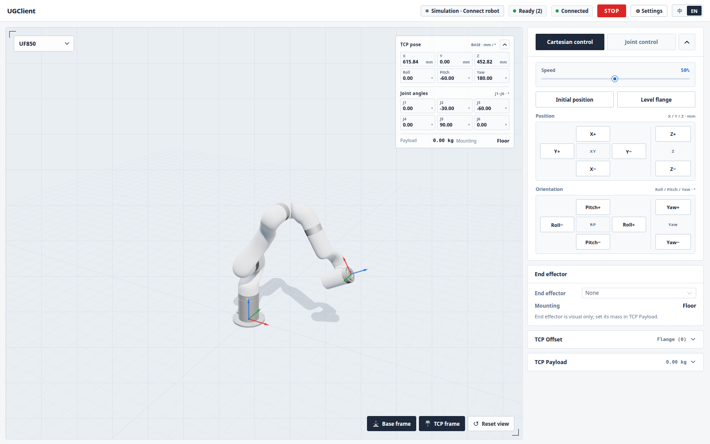
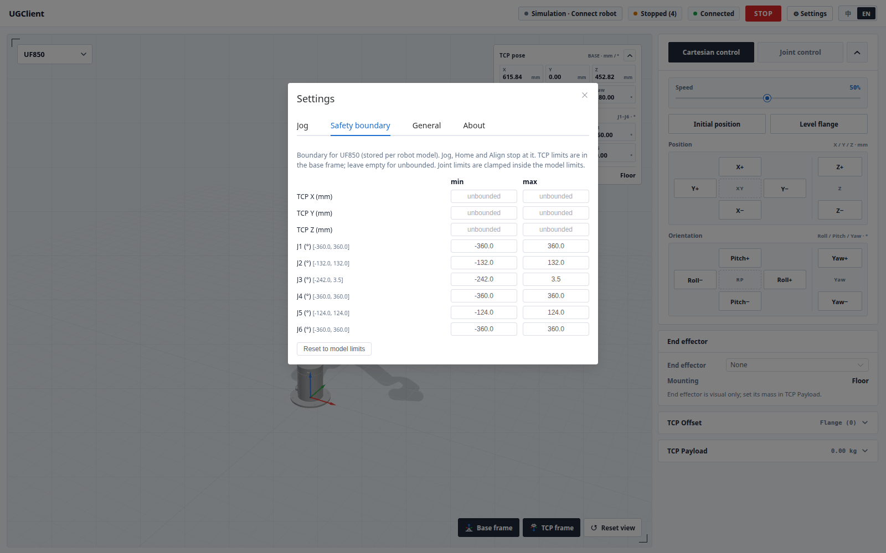

# UGClient

**UGClient = UFACTORY Genesis Client** (formerly *Uclient*).

> **UGClient is currently a personal project in development. It is not an official UFACTORY product and is not affiliated with or endorsed by UFACTORY.**

[中文说明](README.zh.md)

UGClient is an open-source desktop client (Tauri v2 + Vue 3) for **kinematics, dynamics, 3D visualization, and optional physical arm control** of UFACTORY robot arms. It is built on [`ufactory_genesis`](https://github.com/xArm-Developer/ufactory_genesis) and [Pinocchio](https://github.com/stack-of-tasks/pinocchio). Terms and units follow UFACTORY Studio (`mm / °`, `TCP Offset`, `TCP Payload`). It starts in **simulation mode by default**, and can optionally connect to a real UFACTORY controller via `xarm-python-sdk` (default IP `192.168.1.60`); it does not do reinforcement learning.

Supported models: **UF850, xArm5/6/7 (`_1305` revision only), Lite6** (with Gripper G2, BIO Gripper G2, Vacuum Gripper, Robotiq 2F-85, Robotiq 2F-140, Lite6 Gripper, and Lite6 Vacuum Gripper). Platforms: **Linux** (`.deb` package) and **Windows 10+** (NSIS `*-setup.exe` installer, unsigned development builds); macOS is not supported.



## Features

**Layout.** Light two-column desktop workbench:
- **Top header:** `UGClient` title, real-robot connection pill (`Simulation · Connect robot` / active status), motion state pill, engine status pill, red `STOP` button, `⚙ Settings`, and the `中 / EN` language switch.
- **Left 3D stage:** top-left robot model selector, top-right collapsible frosted-glass telemetry card (TCP pose, joint angles, payload, mounting), and bottom-right `Base frame`, `TCP frame`, and `Reset view` buttons.
- **Right sidebar:** collapsible tabbed motion panel (`Cartesian control` / `Joint control`), stacked above the `End effector`, `TCP Offset`, and `TCP Payload` cards.

**Motion controls (simulation & real robot).**
- **Cartesian control:** XY D-pad + Z−/Z+ for position and Roll/Pitch D-pad + Yaw−/Yaw+ for orientation in the base frame (solved via Pinocchio IK in simulation; Roll is disabled on the 5-DOF xArm5).
- **Joint control:** zero-centered bidirectional joint meters (`J1`–`J6`/`J7`) showing joint limits with `−`/`+` jog buttons.
- A **click** moves one step (default `1 mm` / `1°`, configurable in Settings). **Press and hold** for more than `220 ms` moves continuously until release.
- The speed slider defaults to `50%` in simulation (and automatically resets to `20%` when connecting to a real robot). `1%–100%` maps linearly to `2.3–230 mm/s` linear, `1–40 °/s` orientation, and `1–45 °/s` joints.
- **Initial position** (all joints to `0°`) and **Level flange** (turns only the last three joints so the tool points straight down) use the same click/hold behavior.
- Releasing a held button in real-robot mode performs a deceleration stop (`set_state(6)`, falling back to `set_state(4)` if unsupported); **STOP** halts motion immediately (`state = 4`). States are `2` = Ready, `1` = Moving, `4` = Stopped.
- Reaching a joint limit, safety boundary, or unreachable target stops motion and displays a stage notice.

**Real robot control (optional).**
- Always defaults to simulation; hardware access begins only when you explicitly connect in the header dialog (default IP `192.168.1.60`).
- Verifies controller `(axis, device_type)` against supported models and reads live hardware motor enable / brake states (if motors are already enabled with no fault, jogging is unlocked immediately without prompting to re-enable).
- Never clears controller errors automatically. Continuous velocity jogs (`Mode 4` / `Mode 5`) send continuous velocity (`duration=0`) once per hold/speed change with a `0.4 s` sidecar heartbeat watchdog and boundary lookahead, `STOP` bypasses the command lock, and writing `TCP Offset` / `TCP Payload` back to the controller requires the arm to be stationary and explicit confirmation.

**3D view.** Base and TCP coordinate axes are drawn as solid **X red / Y green / Z blue** arrows (always visible over the arm). End effectors load from pre-composed URDFs with default TCP offsets read directly from upstream URDF frames; end-effector meshes are visual only—set tool + workpiece mass in `TCP Payload`.

**Settings** (saved locally):
- **Jog:** click step for linear axes (`0.01–100 mm`) and for angular axes and joints (`0.01–45°`).
- **Safety boundary** (saved per robot model): TCP X/Y/Z min/max in the base frame and per-joint min/max clamped inside model limits. Applies to both simulation and real-robot motion.
- **General:** language, default robot model, and restoring the last session at startup.
- **About:** app, `ugclient-core`, `ufactory_genesis`, Pinocchio versions, and MIT license.



**Engine API without a GUI yet.** The Python engine still provides payload-aware gravity torque (`dyn.gravity`, arm/payload split, % of max torque), `check.pose` (TCP pose to all IK solutions with torques), `kin.ik`, `kin.fk`, `kin.jacobian`, `dyn.rnea`, and `dyn.mass_matrix`. See [schema/api.v1.json](schema/api.v1.json). The app currently has no torque table, CSV export, or IK form.

## Status

Early development (see [docs/DESIGN.md](docs/DESIGN.md) §14).

| Area | State |
|---|---|
| Python engine (`core/`): JSON-RPC 2.0 over WebSocket on 127.0.0.1, token auth | done |
| FK, Jacobian, multi-solution IK (pure Pinocchio, damped least squares) | done |
| Payload-aware gravity torque, RNEA, mass matrix (API only, no GUI yet) | done |
| Real robot control (`real.*` API + UI guard dialog, `xarm-python-sdk`) | done |
| Tauri shell: engine lifecycle, port/token handshake, crash restart | done |
| Main view: two-column workbench, collapsible telemetry & motion tabs, settings | done |
| Linux `.deb` & Windows 10+ NSIS `.exe` packaging in CI / Release | done (unsigned development builds) |
| Torque view, trajectory and torque-over-time curves, workspace and calibration | planned |

Results come from **static models**: nominal URDF inertia, with no friction, gearbox efficiency, or per-unit calibration. Maximum joint torques ([UFACTORY joint parameters](https://docs.supportarticle.ufactory.cc/zhHans/support_articles/hardware/ufactory-joint-parameters.html)) are read at runtime from `ufactory_genesis`, pinned to `v0.3.10` (commit `c167f1e`), which carries the official UFACTORY joint torque limits.

> **Note on unsigned releases:** Development installers (`.deb` and Windows `*-setup.exe`) are unsigned. Windows SmartScreen may show an "Unknown publisher" prompt on first launch; verify downloads with `SHA256SUMS.txt` from the GitHub Release.

## Development

### Linux

Requirements: Python 3.12+ (CI uses 3.12), Node 22 + pnpm, Rust stable, and Tauri system packages (`libwebkit2gtk-4.1-dev librsvg2-dev libappindicator3-dev patchelf libxdo-dev`).

```bash
# 1. Python sidecar + pinned ufactory_genesis (never modified, cloned into third_party/)
python3.12 -m venv .venv
python scripts/fetch_ufg.py
.venv/bin/pip install -e third_party/ufactory_genesis -e "core[dev]"
.venv/bin/python -m pytest core/tests

# 2. Frontend assets and tests
.venv/bin/python scripts/sync_assets.py         # robot URDF + GLB/STL -> apps/desktop/public/robot-assets
cd apps/desktop && pnpm install && pnpm test

# 3. Run the desktop app against the dev sidecar
UGCLIENT_CORE_CMD="$PWD/../../.venv/bin/python -m ugclient_core" pnpm tauri dev

# 4. Package (.deb)
cd ../.. && .venv/bin/python scripts/build_sidecar.py   # PyInstaller onedir + smoke test
cd apps/desktop && pnpm tauri build --bundles deb --config src-tauri/tauri.bundle.conf.json
```

You can also run the frontend in a browser: start `python -m ugclient_core`, then open `http://localhost:1420/?port=<port>&token=<token>` using the handshake line it prints.

### Windows 10+

PyPI does not publish Windows wheels for `pin==4.0.0`, so Windows builds use `conda-forge` (`core/environment-win.yml`) + Node 22 / pnpm + Rust MSVC toolchain:

```bash
# 1. Conda-forge environment (e.g. micromamba / conda)
micromamba create -y -f core/environment-win.yml
micromamba activate ugclient-win
python scripts/fetch_ufg.py
python -m pip install --no-deps "xarm-python-sdk>=1.14" -e third_party/ufactory_genesis -e core

# 2. Build sidecar (PyInstaller onedir + isolated smoke test) & sync assets
python scripts/build_sidecar.py
python scripts/sync_assets.py

# 3. Package Windows NSIS installer (*-setup.exe)
cd apps/desktop && pnpm install --frozen-lockfile
pnpm tauri build --bundles nsis --config src-tauri/tauri.bundle.conf.json
```

## Repository layout

```
apps/desktop/        Vue 3 + TS + Element Plus frontend, three.js viewport, Tauri shell (src-tauri/)
core/ugclient_core/   Python sidecar: server, api/, units.py, backend/ adapter layer
schema/api.v1.json   JSON-RPC API description
scripts/             fetch_ufg.py, sync_assets.py, build_sidecar.py
docs/DESIGN.md       Design document (Chinese)
```

## License

MIT © 2026 Daniel Wang. Robot model assets come from `ufactory_genesis` and its upstream xArm ROS packages; see [NOTICE](NOTICE).
