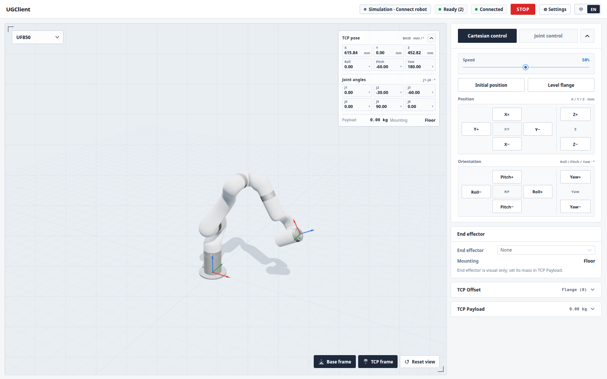
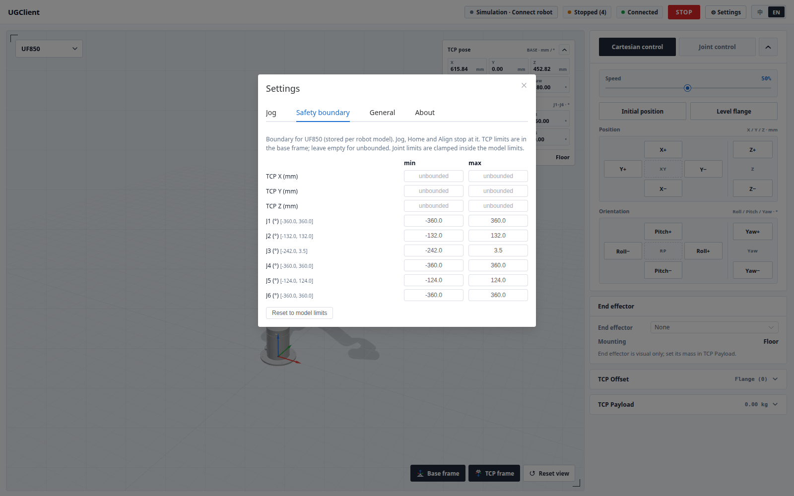

# UFClient

**UFClient = UFACTORY Genesis Client**（原名 *UGClient* / *Uclient*）。

> **UFClient 目前是个人项目，处于开发阶段，不是 UFACTORY 官方产品，与 UFACTORY 无隶属或背书关系。**

[English](README.md)

UFClient 是一个开源桌面客户端（Tauri v2 + Vue 3），基于 [`ufactory_genesis`](https://github.com/xArm-Developer/ufactory_genesis) 和 [Pinocchio](https://github.com/stack-of-tasks/pinocchio)，为 UFACTORY 机械臂提供**运动学、动力学计算、3D 可视化以及可选的真机控制**。术语和单位与 UFACTORY Studio 一致（`mm / °`、`TCP Offset`、`TCP Payload`）。软件启动时默认处于**仿真模式**，也支持通过 `xarm-python-sdk` 可选连接 **UFACTORY 真机控制器**（默认 IP `192.168.1.60`）进行状态监控与受保护的运动控制；不做强化学习。

支持机型：**UF850、xArm5/6/7（仅 `_1305` 版本）、Lite6**（支持末端：Gripper G2、BIO Gripper G2、Vacuum Gripper、Robotiq 2F-85、Robotiq 2F-140、Lite6 Gripper、Lite6 Vacuum Gripper）。平台：**Linux**（`.deb` 安装包）与 **Windows 10+**（NSIS `*-setup.exe` 安装包，未签名的开发构建）；暂不支持 macOS。



## 功能

**界面布局。** 浅色双栏桌面工作台：
- **顶部工具栏**：`UFClient` 标题、真机连接入口（`仿真模式 · 连接真机` / 当前连接状态）、运动状态徽标、引擎状态徽标、红色 `STOP` 按钮、`⚙ 设置` 与 `中 / EN` 语言切换。
- **左侧 3D 舞台**：左上角机型下拉选择、右上角可折叠磨砂卡片（实时显示 TCP 位姿、关节角度、负载质量与安装方式）、右下角 `基坐标系` / `TCP 坐标系` / `复位视角` 按钮。
- **右侧侧栏**：可折叠的双选项卡运动控制面板（`笛卡尔控制` / `关节控制`），下方依次为 `末端工具`、`TCP Offset` 与 `TCP Payload` 配置卡片。

**运动控制（仿真与真机双通道）。**
- **笛卡尔控制**：位置 XY 十字方向盘 + Z−/Z+ 按钮，以及姿态 Roll/Pitch 十字方向盘 + Yaw−/Yaw+ 按钮（基坐标系下运动，仿真走引擎逆解；5 轴 xArm 5 自动禁用独立 Roll 轴）。
- **关节控制**：以零位为中心的双向关节角度进度条（`J1`–`J6`/`J7`），带限位标尺与 `−`/`+` 点动按钮。
- **单击**走一步（默认 `1 mm` / `1°`，可在设置中修改）；**按住**超过 `220 ms` 连续运动，松开即停。
- 速度滑条默认 `50%`（接入真机后自动重置为 `20%` 安全初速），`1%–100%` 线性映射为直线 `2.3–230 mm/s`、姿态 `1–40 °/s`、关节 `1–45 °/s`。
- **初始位置**（所有关节回到 `0°`）和**末端调平**（仅转动最后三个关节使末端法兰朝下）同样采用单击步进 / 长按连续的交互方式。
- 真机模式下松开按住的按钮会执行减速停止（`set_state(6)`，旧固件自动回退 `set_state(4)`）；点击 **STOP** 立即停止且状态变为 `4`。状态码：`2` = 就绪，`1` = 运动中，`4` = 已停止。
- 触发关节限位、安全边界或目标不可达时，运动停止并在 3D 舞台顶部显示非阻塞提示条。

**真机控制（可选）。**
- 默认只跑仿真；仅当用户在顶部弹窗中显式发起连接（默认 IP `192.168.1.60`）后才与实体控制器通信。
- 连接时先校验控制器 `(axis, device_type)` 与机型是否匹配，并实时读取硬件电机使能与抱闸状态（若机械臂已使能且无错则直接就绪，无需重复使能）。
- 存在控制器错误时绝不自动清错；切入真机后速度重置为 `20%`；连续速度点动（Mode 4 / Mode 5）在起动或变速时单次下发 `duration=0` 连续速度，并由 `0.4 s` 侧边车心跳看门狗与安全边界前瞻持续护航；`STOP` 走无锁快速通道；TCP Offset 与 TCP Payload 仅允许在静止确认后回写控制器。

**3D 视图。** 浅色网格地面与投影，基坐标系与 TCP 坐标轴以实心 **X 红 / Y 绿 / Z 蓝** 箭头绘制（始终置顶显示在机械臂上方）。末端执行器模型（兼容 GLB/STL 视觉网格）从预组装 URDF 加载，默认 TCP 直接读取自上游组合 URDF；末端模型仅作外观与默认 TCP 参考，质量请在 `TCP Payload` 中统一设置。

**设置**（保存在本地）：
- **点动**：直线单击步长（`0.01–100 mm`）和角度单击步长（`0.01–45°`，用于关节和 RPY）。
- **安全边界**（按机型分别保存）：基坐标系下 TCP X/Y/Z 范围与各关节范围（限制在机型限位以内），同时约束仿真与真机运动。
- **通用**：语言、默认机型、启动时恢复上次配置。
- **关于**：应用、计算引擎、`ufactory_genesis`、Pinocchio 版本与 BSD-3-Clause 许可证。



**暂无界面的引擎接口。** Python 计算引擎仍提供：负载感知重力扭矩（`dyn.gravity`，本体/负载分解、占最大扭矩百分比），`check.pose`（TCP 位姿 → 全部逆解及对应扭矩），以及 `kin.ik`、`kin.fk`、`kin.jacobian`、`dyn.rnea`、`dyn.mass_matrix`。接口说明见 [schema/api.v1.json](schema/api.v1.json)。目前界面上没有扭矩表、CSV 导出和逆解输入表单。

## 当前状态

早期开发（见 [docs/DESIGN.md](docs/DESIGN.md) §14）。

| 模块 | 状态 |
|---|---|
| Python 计算引擎（`core/`）：127.0.0.1 上的 WebSocket JSON-RPC 2.0，token 认证 | 已完成 |
| FK、雅可比、多解 IK（纯 Pinocchio，阻尼最小二乘） | 已完成 |
| 负载感知重力扭矩、RNEA、质量矩阵（仅接口，暂无界面） | 已完成 |
| 真机控制（`real.*` 接口 + 监控/使能弹窗与双通道安全护栏） | 已完成 |
| Tauri 壳：引擎生命周期、端口/token 握手、崩溃重启 | 已完成 |
| 主界面：双栏工作台、可折叠位姿卡片与控制面板、RGB 坐标轴、设置页 | 已完成 |
| CI / Release 构建 Linux `.deb` 与 Windows 10+ NSIS `.exe` 安装包 | 已完成（未签名的开发构建） |
| 扭矩视图、轨迹与扭矩随时间变化曲线、工作空间与标定 | 计划中 |

计算结果来自**静态模型**：URDF 名义惯性参数，不含摩擦、减速器效率和单机标定。最大关节扭矩（[UFACTORY 关节参数](https://docs.supportarticle.ufactory.cc/zhHans/support_articles/hardware/ufactory-joint-parameters.html)）运行时从 `ufactory_genesis` 读取，当前锁定 `v0.3.10`（commit `c167f1e`），已包含 UFACTORY 官方关节扭矩限值。

> **未签名包提示**：目前发布的 Linux `.deb` 与 Windows `*-setup.exe` 均为未签名开发构建，Windows 首次运行可能触发 SmartScreen「未知发布者」提示，请结合 Release 附带的 `SHA256SUMS.txt` 校验文件完整性。

## 开发与打包

### Linux

需要 Python 3.12+（CI 使用 3.12）、Node 22 + pnpm、Rust stable，以及 Tauri 系统依赖（`libwebkit2gtk-4.1-dev librsvg2-dev libappindicator3-dev patchelf libxdo-dev`）。

```bash
# 1. Python 引擎 + 锁定版本的 ufactory_genesis（只读使用，克隆到 third_party/）
python3.12 -m venv .venv
python scripts/fetch_ufg.py
.venv/bin/pip install -e third_party/ufactory_genesis -e "core[dev]"
.venv/bin/python -m pytest core/tests

# 2. 前端资源与测试
.venv/bin/python scripts/sync_assets.py
cd apps/desktop && pnpm install && pnpm test

# 3. 用开发版引擎运行桌面应用
UFCLIENT_CORE_CMD="$PWD/../../.venv/bin/python -m ufclient_core" pnpm tauri dev

# 4. 打包（.deb）
cd ../.. && .venv/bin/python scripts/build_sidecar.py
cd apps/desktop && pnpm tauri build --bundles deb --config src-tauri/tauri.bundle.conf.json
```

也可以直接在浏览器中调试前端：先启动 `python -m ufclient_core`，再用输出中的端口和 token 打开 `http://localhost:1420/?port=<port>&token=<token>`。

### Windows 10+

由于 PyPI 暂未提供 `pin==4.0.0` 的 Windows wheel，Windows 构建通过 `conda-forge`（`core/environment-win.yml`）+ Node 22 / pnpm + Rust MSVC 工具链完成：

```bash
# 1. 创建 conda-forge 环境（推荐 micromamba / conda）
micromamba create -y -f core/environment-win.yml
micromamba activate ufclient-win
python scripts/fetch_ufg.py
python -m pip install --no-deps "xarm-python-sdk>=1.14" -e third_party/ufactory_genesis -e core

# 2. 打包 sidecar（PyInstaller onedir + 隔离环境冒烟测试）并同步 3D 资源
python scripts/build_sidecar.py
python scripts/sync_assets.py

# 3. 构建 Windows NSIS 安装包（*-setup.exe）
cd apps/desktop && pnpm install --frozen-lockfile
pnpm tauri build --bundles nsis --config src-tauri/tauri.bundle.conf.json
```

## 仓库结构

```
apps/desktop/        Vue 3 + TS + Element Plus 前端、three.js 视口与 Tauri 壳（src-tauri/）
core/ufclient_core/   Python 引擎：server、api/、units.py、backend/ 适配层
schema/api.v1.json   JSON-RPC 接口描述
scripts/             fetch_ufg.py、sync_assets.py、build_sidecar.py
docs/DESIGN.md       设计文档
```

## 许可证

BSD-3-Clause © 2026 Daniel Wang。机器人模型资源来自 `ufactory_genesis` 及其上游 xArm ROS 描述包，详见 [NOTICE](NOTICE)。
